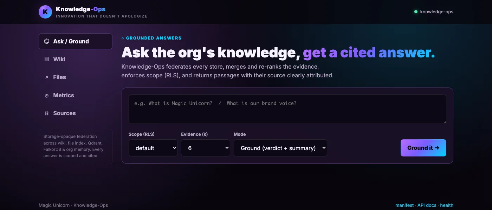
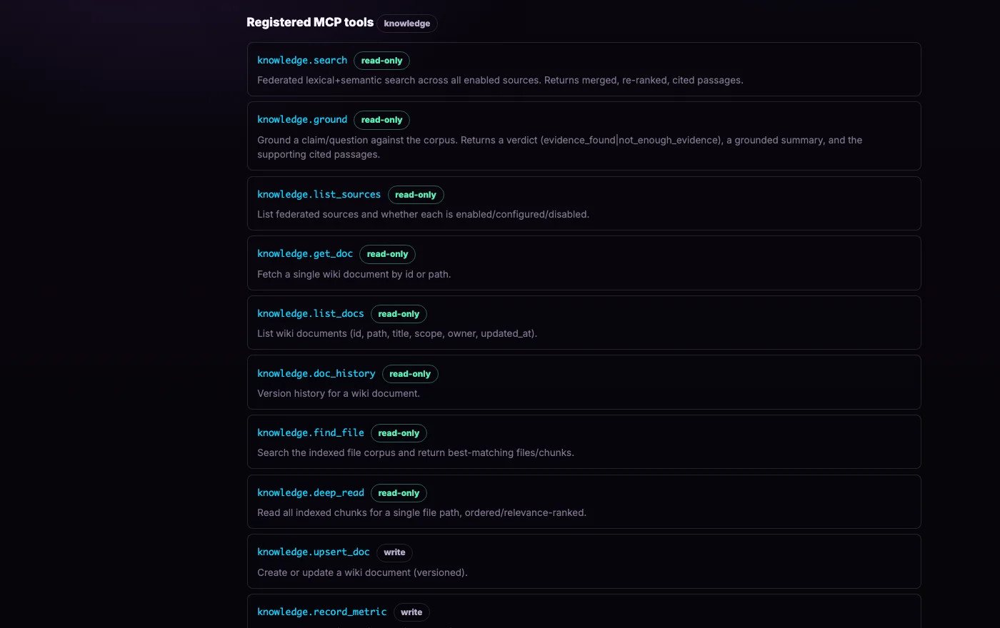
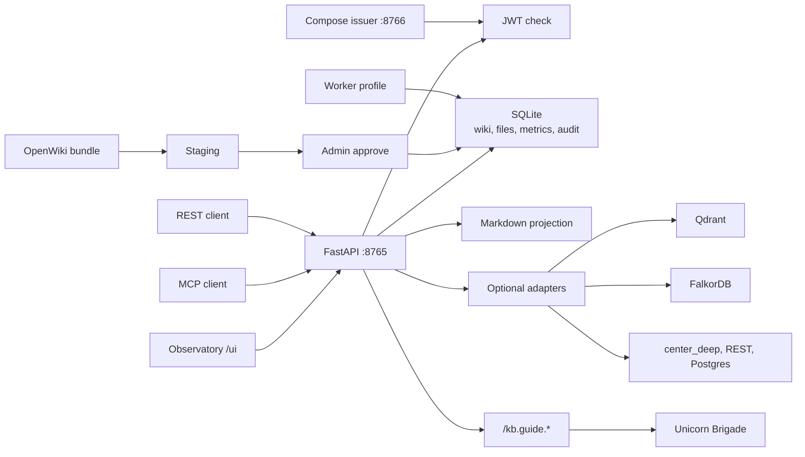

<div align="center">


# Knowledge-Ops

**The wiki and memory your agents ground on.**

Versioned pages, cited search, and an approval gate before an import becomes canonical. Self-hosted. One process serves the UI, the REST API, and MCP.

[](LICENSE)
[](pyproject.toml)
[](pyproject.toml)
[](pyproject.toml)
[](#built-for-agents)
[](#architecture)
[](#quick-start)

[Quick start](#quick-start) · [Features](#highlights) · [Agents](#built-for-agents) · [Architecture](#architecture) · [Suite](#part-of-unicorn-commander)

</div>

<p align="center">
  
  <br>
  <em>The wiki.</em>
</p>

## What is Knowledge-Ops?

Knowledge-Ops is the governed evidence layer in the [Unicorn Commander](https://unicorncommander.com) suite. It keeps canonical documents in a versioned wiki, indexes local files, and returns cited passages over REST and MCP. Agents call `search` and `ground`. An OpenWiki import stays in staging until an administrator approves it. You run the service yourself. By default, every `/kb.*` call requires a verified OIDC or Brigade bearer token and is authorized in the application; explicitly disabling API auth uses a local administrator principal.

Automated grounding is a lexical heuristic. Each ground response sets `verification_status` to `heuristic_not_verified`.

## Highlights

- **Versioned wiki.** Pages have history, `valid_from` / `valid_until`, supersession, and tombstones. `as_of` selects documents whose validity interval contains an ISO 8601 time, using their latest stored bodies. Tombstoned content stays out of search, including historical queries. See [Governed Memory Lifecycle](docs/MEMORY-LIFECYCLE.md).
- **Wikilinks.** The library resolves `[[wikilinks]]`, draws backlinks, and lists missing targets and orphans from `GET /kb.links`.
- **Cited federation.** One query merges the wiki, the file index, a local JSONL memory file when that file is present, and any enabled Qdrant, FalkorDB, `center_deep`, REST, or read-only Postgres source. Disabled adapters return an empty list. When a live adapter raises, that source is dropped and the other hits are still returned.
- **Heuristic grounding.** `POST /kb.ground` returns a verdict of `possible_support`, `possible_contradiction`, `possible_conflict`, `related_evidence`, or `not_enough_evidence`, plus the passages that produced it.
- **Citation inspection.** `POST /kb.inspect_citation` returns the authorized source span behind a `wiki` or `file_index` citation.
- **OpenWiki review.** Bundles are staged and scanned; promotion requires an administrator. Run the external producer without a writable mount of the canonical wiki. See [OpenWiki Governance](docs/OPENWIKI-GOVERNANCE.md).
- **Visibility in the app.** Wiki and search reads apply the principal’s identity, `personal`, `global`, or `workspace:<id>` scope, and workspace/project bindings. Wiki writes accept `personal` or `global` scope and require write permissions. Global content without a workspace binding is hidden from non-admins by default. `scope=all` is reserved for a knowledge administrator.
- **One process, no frontend build.** The Observatory at `/ui/` is static HTML and JavaScript served by FastAPI: Ask, Library, Review, Files, Sources, Graph, Operations, and Help.

## Feature tour

### The wiki

The Library is an encyclopedia view of the wiki: a page tree, the article, and a rail with scope, owner, versions, and backlinks. Create and edit Markdown in the browser, including `[[wikilink]]` completion. `POST /kb.upsert_doc` writes the same pages from an agent. Personal pages belong to the caller. A global write requires `write:knowledge:global`.

`GET /kb.docs` lists what the caller may see. `GET /kb.get_doc` fetches one page. `GET /kb.doc_history?id=<doc>` lists saved-version metadata; `GET /kb.doc_version?id=<doc>&version_id=<version>` returns a prior body. `POST /kb.delete_doc` records a reason and tombstones the page. Personal deletion requires the owner with read/write access or an administrator. Global deletion requires a knowledge administrator.

The standalone compose leaves seed ingestion off (`KNOWLEDGE_OPS_SEED_INTERNAL_CORPUS=0`). The Docker build also refuses any `*.md` under `wiki/` unless you pass `--build-arg KNOWLEDGE_OPS_SEED_CORPUS=internal`. Startup ingests previously unknown Markdown paths only when the runtime flag is `1`.

### A page and its sources

A page is canonical Markdown in SQLite, with a Markdown projection on disk that startup can rebuild. Search and grounding responses include passages from the wiki, indexed files, and any configured sources that returned accessible matches. `GET /kb.list_sources` returns an `enabled` flag and a source-specific status, including local storage types, `configured`, `disabled`, or `blocked-missing-auth-contract`. The Sources view combines that catalog, source counts, and the MCP tool list.

`POST /kb.inspect_citation` with `source`, `source_id`, and `claim` returns the authorized span for a wiki or file-index hit. Revision-bound wiki citations fail after the source changes; legacy file chunks without spans need reindexing. The file index only walks directories under `KNOWLEDGE_OPS_FILE_ROOT`, skips symlinks, skips names that look like secrets, and indexes a fixed set of text suffixes.

### Search and grounded answers

<p align="center">
  
  <br>
  <em>Search and grounded answers.</em>
</p>

Ask has two modes. **Passages** calls `POST /kb.search` and returns the top merged hits. **Assess** calls `POST /kb.ground` and adds the heuristic verdict. Both REST endpoints accept `query`, optional `scope` (`global`, `personal`, `workspace:<id>`, or admin-only `all`), optional `sources`, optional `k` (1–50, default 8), and optional `as_of`. Ask sends `query`, `scope`, and `k`; source selection and `as_of` are API options. An `as_of` request defaults to the wiki and rejects other sources.

The answer text is evidence excerpts. Assess labels its verdict as heuristic and displays the API verdict names with spaces in place of underscores.

## Built for agents

<p align="center">
  
</p>

Knowledge-Ops exposes MCP over HTTP and over stdio, plus a small chat proxy to Unicorn Brigade.

### HTTP-MCP

`POST /mcp` speaks MCP JSON-RPC over HTTP: `initialize`, `ping`, `tools/list`, and `tools/call`. The protocol version string is `2025-06-18`. The tool catalog is the `tools` array in [`.well-known/mcps.json`](.well-known/mcps.json), also served at `GET /.well-known/mcps.json`. That catalog has **16 tools**. The handler dispatches on the last dotted segment, so `search` and `knowledge.search` call the same function.

By default, every HTTP-MCP method requires a bearer JWT: RS256, audience `KNOWLEDGE_OPS_MCP_AUDIENCE`, issuer in `KNOWLEDGE_OPS_MCP_TRUSTED_ISSUERS`, signature checked against `KNOWLEDGE_OPS_MCP_JWKS_URL`. `tools/call` then checks the manifest’s required scopes (`read:knowledge` or `write:knowledge`); `whoami` requires authentication but no scope. Setting `KO_MCP_ALLOW_ANONYMOUS_DISCOVERY=true` opens discovery methods only. It never opens `tools/call`. The default is closed.

The standalone compose points that JWKS URL at its own issuer, so the bootstrap admin token below works for `/mcp`.

| Tool | What an agent uses it for |
|---|---|
| `search` | Federated retrieval. Cited passages, no verdict. |
| `ground` | The same retrieval plus a heuristic verdict. |
| `list_sources` | Which stores are enabled. |
| `get_doc`, `list_docs`, `doc_history` | Read the wiki the caller is allowed to see. |
| `upsert_doc`, `delete_doc` | Write or tombstone a page. |
| `inspect_citation` | The authorized span behind a wiki or file citation. |
| `find_file`, `deep_read` | Search the file index, or retrieve up to `k` stored chunks from one indexed path. |
| `graph`, `links`, `stats` | The constellation graph, wikilinks, and source counts the UI uses. |
| `whoami` | The caller's subject, scopes, and admin flag. Same payload as `GET /kb.me`. |
| `record_metric` | Append a named timeseries point. |

`kb.get_metric_chart` exists on the stdio server and as `GET /kb.get_metric_chart`. It is not one of the 16 HTTP-MCP tools.

### stdio MCP

The stdio server is `python3 -m knowledge_ops.mcp_server` (extra `knowledge-ops[mcp]`). It registers **17 tools**, the HTTP set under `kb.*` names plus `kb.get_metric_chart`. It runs as the local system principal, which holds `admin:knowledge`. Use it on a machine you trust. `kb.ground` names its first argument `claim`. HTTP and the manifest name that field `query`.

```json
{
  "mcpServers": {
    "knowledge-ops": {
      "command": "python3",
      "args": ["-m", "knowledge_ops.mcp_server"],
      "cwd": "<path-to-this-repo>"
    }
  }
}
```

Install the extra first: `python -m pip install -e '.[mcp]'`.

An HTTP client that can send a header looks like this. Replace the token. Do not commit it.

```json
{
  "mcpServers": {
    "knowledge-ops": {
      "url": "http://127.0.0.1:8765/mcp",
      "headers": {
        "Authorization": "Bearer <token>"
      }
    }
  }
}
```

### Brigade guide

`GET /kb.guide.agents` lists [Unicorn Brigade](https://github.com/Unicorn-Commander/Unicorn-Brigade) agents; `POST /kb.guide.chat` sends a chat turn to one. After authorization, both return HTTP 503 (`guide-not-configured`) when `KNOWLEDGE_OPS_BRIGADE_KEY` is empty. `GET /kb.guide.info` stays local and reports `configured`. The key is sent upstream as `X-API-Key` and is omitted from the response. The standalone compose leaves the guide unset.

`scripts/register_librarian_agent.sql` is a Brigade registration for a worker called the Librarian, whose prompt tells it to call `knowledge.search` and `knowledge.ground`. `scripts/register_ops_center_catalog.sql` registers the `knowledge_ops_access` entitlement with Ops-Center. Neither script runs on `docker compose up`.

## Quick start

Docker Engine and the Compose plugin are enough. No `.env` file is required. [`.env.example`](.env.example) lists optional overrides. If you create a `.env`, keep it untracked.

The compose file publishes the API on **127.0.0.1:8765** only, stores SQLite and the wiki in named volumes, leaves Qdrant, FalkorDB, and `center_deep` off, and pins `KNOWLEDGE_OPS_SEED_INTERNAL_CORPUS` to `0`. It also starts a local RS256 issuer, `knowledge-ops-auth`, on the compose network only (port 8766 inside the network, with no host port).

The browser client sends the session cookie and leaves `Authorization` for a proxy to attach ([`knowledge_ops/static/ui/api.js`](knowledge_ops/static/ui/api.js)). This compose file has no proxy, and it publishes the API on loopback only. Open the Observatory with API auth off. `POST /mcp` still requires the bootstrap token.

### See the wiki

```bash
KNOWLEDGE_OPS_API_REQUIRE_AUTH=0 docker compose up -d --build
curl -fsS http://127.0.0.1:8765/ready
```

`/ready` returns ok when the SQLite database, the schema, the wiki directory, and the OpenWiki staging directory are ready. When `KNOWLEDGE_OPS_REQUIRE_WORKER` is on, the worker heartbeat is part of that check too. The standalone file leaves the worker off.

Open <http://127.0.0.1:8765/ui/>. `/` redirects to the public landing page at `/landing/`.

Auth off is for this loopback bind. Put a trusted issuer in place before you publish the port on any other address.

### Call the API and MCP

With the default (`KNOWLEDGE_OPS_API_REQUIRE_AUTH=1`), the issuer writes one bootstrap admin token on first start. The signing key, public JWK, and token stay on the `knowledge_ops_bootstrap_auth` volume, mounted only by `knowledge-ops-auth`. The API receives the public JWKS over the compose network. The service does not print the token. It is valid for 90 days, mode `0600`, and a restart keeps it while it still verifies.

```bash
docker compose up -d --build
curl -fsS http://127.0.0.1:8765/ready
```

Read the generated token into a shell variable and check the caller:

```bash
ADMIN_TOKEN="$(docker compose run --rm --no-deps --entrypoint cat knowledge-ops-auth /data/bootstrap-auth/bootstrap-admin.token)"
curl -fsS http://127.0.0.1:8765/kb.me -H "Authorization: Bearer $ADMIN_TOKEN"
```

The identity response has `name` `bootstrap-admin` and `is_admin` `true`. Keep the token in the shell or a secret store. The bootstrap token is the self-host credential for this compose file. This repository does not implement hosted signup or per-agent personal access tokens. A deployment past loopback uses its own OIDC or Brigade issuer.

```bash
curl -fsS -X POST http://127.0.0.1:8765/kb.ground \
  -H "Authorization: Bearer $ADMIN_TOKEN" \
  -H "Content-Type: application/json" \
  -d '{"query":"What evidence is available?","scope":"global","k":6}'

curl -fsS -X POST http://127.0.0.1:8765/mcp \
  -H "Authorization: Bearer $ADMIN_TOKEN" \
  -H "Content-Type: application/json" \
  -d '{"jsonrpc":"2.0","id":1,"method":"tools/list"}'
```

REST routes use dot notation: `/kb.search`, `/kb.ground`, `/kb.list_sources`, `/kb.docs`. OpenAPI is at <http://127.0.0.1:8765/docs>.

The application declares **48 routes**: 40 on the main app, 5 on the graph router, 3 on the guide router. FastAPI also serves `/docs`, `/redoc`, and `/openapi.json`. Static files are mounted at `/ui` and `/landing`.

### Optional worker

The optional worker schedules refresh jobs, runs local review scans, and retries local projection cleanup. Enable it when you need that work:

```bash
docker compose --profile worker up -d --build
```

External connector refresh and source-owner deletion require explicitly registered adapters with process-owned credentials; the default worker registers none. The worker container runs `knowledge-ops worker`. Its healthcheck is `knowledge-ops worker-health`. Set `KNOWLEDGE_OPS_REQUIRE_WORKER=1` on the API when `/ready` must include a fresh worker heartbeat.

A non-Docker unit file is at [`deploy/knowledge-ops.service`](deploy/knowledge-ops.service). It listens on all interfaces, so set the issuer variables before you enable it. The compose file above is the quick start.

## Run from source

Python 3.11 or newer. The image and CI use 3.12. From the repository root:

```bash
python3 -m venv .venv
source .venv/bin/activate
python -m pip install pip==26.1.2
python -m pip install --require-hashes --requirement requirements.lock
python -m pip install --no-deps -e .
export KNOWLEDGE_OPS_API_REQUIRE_AUTH=0
export KNOWLEDGE_OPS_DATA="$PWD/data"
export KNOWLEDGE_OPS_DB="$PWD/data/knowledge_ops.sqlite3"
export KNOWLEDGE_OPS_WIKI="$PWD/wiki"
export KNOWLEDGE_OPS_OPENWIKI_STAGING="$PWD/data/openwiki/staging"
python -m knowledge_ops.cli init
python -m uvicorn knowledge_ops.api:app --host 127.0.0.1 --port 8765
```

`pip install -e '.[all]'` is the shorter install when you do not need the hashed lock. The `all` extra adds MCP and the Redis client used by FalkorDB. Bind stays on `127.0.0.1` while auth is off.

This path does not start a local issuer. By default, HTTP-MCP still rejects requests without a valid bearer even when REST auth is off. Configure `KNOWLEDGE_OPS_MCP_JWKS_URL`, `KNOWLEDGE_OPS_MCP_AUDIENCE`, and `KNOWLEDGE_OPS_MCP_TRUSTED_ISSUERS` for a trusted signer and send its token, or use the compose issuer above.

The CLI entry point is `knowledge-ops` (`python -m knowledge_ops.cli`). Useful subcommands include `init`, `search`, `ground`, `upsert-doc`, `index-files`, `evaluate-memory`, `worker`, `worker-health`, `backup`, and `restore-verify`.

`python3 dev/mock_api.py` is a stdlib harness that serves the static UI with canned JSON. It is for UI work. It is not the service.

## Configuration

Copy optional Compose overrides from [`.env.example`](.env.example) into a host-only `.env`. Compose passes only variables wired into its service configuration; other settings need an `environment` or `env_file` override. For source runs, export variables in the process environment. Do not commit filled-in secrets. Each bearer must match the issuer, audience, and JWKS configured for its verifier.

| Variable | Meaning |
|---|---|
| `KNOWLEDGE_OPS_DATA` | Runtime data directory and default staging parent; set the SQLite path separately with `KNOWLEDGE_OPS_DB`. |
| `KNOWLEDGE_OPS_DB` | SQLite file path. Canonical store. |
| `KNOWLEDGE_OPS_WIKI` | Markdown projection directory. |
| `KNOWLEDGE_OPS_OPENWIKI_STAGING` | Content-addressed staging directory for OpenWiki imports. |
| `KNOWLEDGE_OPS_SEED_INTERNAL_CORPUS` | `1` ingests `*.md` from the wiki directory at startup as global pages. Compose sets `0`. |
| `KNOWLEDGE_OPS_API_REQUIRE_AUTH` | `1` requires a bearer token on API routes. `0` uses a local admin principal. Leave `0` only on a loopback bind. |
| `KNOWLEDGE_OPS_API_AUDIENCE` | Expected `aud` for OIDC tokens. |
| `KNOWLEDGE_OPS_API_DEFAULT_OIDC_SCOPES` | Scopes added to a verified OIDC principal. |
| `KNOWLEDGE_OPS_API_OIDC_JWKS_URL` | JWKS URL for OIDC signature checks. |
| `KNOWLEDGE_OPS_API_TRUSTED_ISSUERS` | Comma-separated OIDC issuers that are accepted. |
| `KNOWLEDGE_OPS_MCP_JWKS_URL` | JWKS URL for HTTP-MCP and for bearers whose issuer is an MCP issuer. |
| `KNOWLEDGE_OPS_MCP_AUDIENCE` | Expected `aud` for those tokens. |
| `KNOWLEDGE_OPS_MCP_TRUSTED_ISSUERS` | Comma-separated issuers verified as Brigade-style JWTs. |
| `KNOWLEDGE_OPS_ENABLE_QDRANT` | `1` queries Qdrant. Needs an embedding endpoint. |
| `KNOWLEDGE_OPS_ENABLE_FALKORDB` | `1` runs read-only graph queries. Needs the `live` extra (`redis`). |
| `KNOWLEDGE_OPS_ENABLE_CENTER_DEEP` | `1` queries the `center_deep` HTTP adapter. |
| `KNOWLEDGE_OPS_REQUIRE_WORKER` | `1` makes `/ready` depend on a fresh worker heartbeat. |

OIDC role names the app maps are `knowledge-reader`, `knowledge-editor`, and `knowledge-admin`. A Brigade-style token carries scopes directly (`read:knowledge`, `write:knowledge`, `write:knowledge:global`, `admin:knowledge`).

Adapter URLs, the embedding model, the Brigade guide, OpenWiki import roots, the file-index allowlist (`KNOWLEDGE_OPS_FILE_ROOT`), and `KNOWLEDGE_OPS_CLIENT_WORKSPACE_MAP` are further settings in [`knowledge_ops/config.py`](knowledge_ops/config.py). Configure the relevant settings before enabling an integration. The client workspace map supplies workspace/project grants for a verified `azp` or `client_id` only when workspace claims are absent. Qdrant requests `BAAI/bge-m3` by default; vector dimensions come from the embedding endpoint’s response.

Credentials for external adapters belong in a host-only environment file. Backup and restore behavior is specified in [Operations Runbook](docs/OPERATIONS-RUNBOOK.md). The scripts are [`scripts/backup.sh`](scripts/backup.sh) and [`scripts/restore_verify.sh`](scripts/restore_verify.sh).

## Architecture



- **API** (`knowledge_ops/api.py`). FastAPI application. UI, REST, readiness, and `POST /mcp`. Default listen port **8765**.
- **Authorization** (`knowledge_ops/authorization.py`, `knowledge_ops/brigade_auth.py`). Turns a verified OIDC or Brigade JWT into a principal. Federation applies that principal after every adapter.
- **Wiki** (`knowledge_ops/wiki.py`, `knowledge_ops/wikilinks.py`). SQLite is canonical. Markdown on disk is a projection.
- **File index, metrics, citations, OpenWiki, memory quality, operations.** Local SQLite subsystems behind `/kb.*` routes. Schema version is **4**.
- **Graph** (`knowledge_ops/graph_api.py`). `/kb.graph`, `/kb.links`, `/kb.stats`, `/kb.me`, `/kb.doc_version`.
- **Guide** (`knowledge_ops/guide_api.py`). Included at startup when the module loads. After authorization, chat and the agent list return HTTP 503 (`guide-not-configured`) when `KNOWLEDGE_OPS_BRIGADE_KEY` is empty. `GET /kb.guide.info` stays local and reports whether the key is configured.
- **Issuer.** Defined in [`docker-compose.yml`](docker-compose.yml), not in the image command. JWKS at `/.well-known/jwks.json` on port 8766 inside the compose network.
- **Worker** (`knowledge_ops/worker.py`). Optional compose profile. Durable refresh and deletion retries.
- **Adapters** (`knowledge_ops/adapters/`). Qdrant, FalkorDB, and `center_deep` default off behind enable flags. Local JSONL memory is read when its configured file exists. REST and Postgres use explicit source configurations and require authorization contracts.

## Part of Unicorn Commander

| App | What it does |
|---|---|
| [Ops-Center](https://github.com/Unicorn-Commander/Ops-Center) | The control plane: tenants, billing, federation, API keys, model routing |
| [Unicorn-Brigade](https://github.com/Unicorn-Commander/Unicorn-Brigade) | The agent layer: agents, tools, memory, orchestration |
| [Unicorn-Stable](https://github.com/Unicorn-Commander/Unicorn-Stable) | Humans and agents in the same room: chat, voice, video |
| [Accounting-Ops](https://github.com/Unicorn-Commander/Accounting-Ops) | Agent-native accounting and books |
| [Contact-Ops](https://github.com/Unicorn-Commander/Contact-Ops) | The shared contact and identity graph |
| [Customer-Ops](https://github.com/Unicorn-Commander/Customer-Ops) | Customers, pipeline, quotes and outreach |
| [Email-Ops](https://github.com/Unicorn-Commander/Email-Ops) | Agent-drafted email with a human approval inbox |
| [Project-Ops](https://github.com/Unicorn-Commander/Project-Ops) | Projects, tasks, time and invoices |
| [Meeting-Ops](https://github.com/Unicorn-Commander/Meeting-Ops) | Recordings, transcripts, summaries and action items |
| **[Knowledge-Ops](https://github.com/Unicorn-Commander/Knowledge-Ops)** | **The wiki and memory your agents ground on** |
| [Security-Ops](https://github.com/Unicorn-Commander/Security-Ops) | Authorized security scanning with engagement and attestation gates |
| [Tax-Planning-Ops](https://github.com/Unicorn-Commander/Tax-Planning-Ops) | Tax plans, scenarios and statutory deadlines |
| [Brand-Ops](https://github.com/Unicorn-Commander/Brand-Ops) | Brand kits, marks, voices and rules |
| [Podcast-Ops](https://github.com/Unicorn-Commander/Podcast-Ops) | Episode scripts, audio rendering, mixing and review |
| [UUDA](https://github.com/Unicorn-Commander/UUDA) | The device agent for your fleet |
| [fleet-map](https://github.com/Unicorn-Commander/fleet-map) | Fleet inventory and topology map |

With API auth enabled, Knowledge-Ops verifies OIDC or Brigade bearer tokens on `/kb.*` calls. HTTP-MCP uses its separate JWT gate. The app publishes its tool catalog for the Brigade broker and proxies chat through `POST /kb.guide.chat` when `KNOWLEDGE_OPS_BRIGADE_KEY` is set. `scripts/register_ops_center_catalog.sql` registers the `knowledge_ops_access` entitlement with Ops-Center.

## Development

The documented integration branch is `codex/knowledge-openwiki-hardening`, and CI’s push trigger targets it. CI ([`.github/workflows/ci.yml`](.github/workflows/ci.yml)) installs [`requirements.lock`](requirements.lock), then runs these checks:

```bash
python -m pip install pytest==9.0.2 ruff==0.15.13
python -m pytest -q
python -m knowledge_ops.cli evaluate-memory
ruff check knowledge_ops tests
python -m compileall -q knowledge_ops tests
find knowledge_ops/static/ui -name '*.js' -print0 | xargs -0 -n1 node --check
docker compose config --quiet
docker compose --profile worker config --quiet
```

`pytest --collect-only` reports **213** tests. CI runs that suite, `evaluate-memory`, and `ruff check` with no extra service containers. `evaluate-memory` exits non-zero when its check fails. `ruff` is pinned in the `test` extra and has no extra config in `pyproject.toml`, so CI uses ruff's defaults. The JavaScript check needs Node (CI uses Node 22).

See [CONTRIBUTING.md](CONTRIBUTING.md) before you open a pull request.

## Security

Report a vulnerability privately. The process is in [SECURITY.md](SECURITY.md). Do not open a public issue for a security report, and do not include tokens, keys, or private data.

Every `/kb.*` handler depends on an application principal. `/health` and `/ready` are unauthenticated liveness and readiness. `/metrics` is OpenMetrics and requires a knowledge administrator.

## Licence

Knowledge-Ops is licensed under the GNU Affero General Public License v3.0 or later. See [LICENSE](LICENSE).

<p align="center">Built by <a href="https://magicunicorn.tech">Magic Unicorn</a> · part of <a href="https://unicorncommander.com">Unicorn Commander</a></p>
